# 바이너리 프로토콜 전환 · 이동 입력 제한 — 결과 정리

> 기간 2026-10-12 13:57 ~ 10-13 15:37(약 26시간) · 브랜치 `bun-to-cpp-server` · 커밋 29개(`bb405cd` ~ `7f3a93e`)
> 자세한 기록: 결정 [ADR 0003](../adr/0003-binary-body-codec.md) · 측정 [perf-baseline.md](../perf-baseline.md) "이진 전환 B2b / B3b / B6 — 최종" · 와이어 사양 [protocol.md](../../shared/protocol.md)
> 처음 보는 용어는 [6. 용어 풀이](#6-용어-풀이)에 모아 두었다.

## 요약

**서버와 클라가 주고받는 패킷 71개가 전부 바이너리(이진)가 됐고, 이동 입력의 구멍 두 개를 막았다.**

- 바이너리 전환: 70개를 바꿨다(위치 갱신 1개는 원래 바이너리). 이제 JSON 본문 패킷은 0개다.
- 막은 구멍: **클릭 이동 요청 무제한**, **키보드 이동으로 벽 통과**.
- 네트워크: 서버가 받는 바이트 **−56%**, 월드 → 게이트웨이 내부 통신 **−45%**.
- CPU: **5~8%** 줄었다.
- 처음 노렸던 **tick 꼬리(p99)는 줄었다고 확인되지 않았다**(1150명 −15%는 판정 보류). JSON을 걷어내자 monolith의 메모리 할당은 8~11% 줄었지만,
  월드 서버의 짧은 청소(eden) 빈도는 줄지 않았다. 프로토콜 JSON은 GC의 주원인이 아니었다는 뜻이다. 진짜 할당원은 다음 과제로 찾는다.

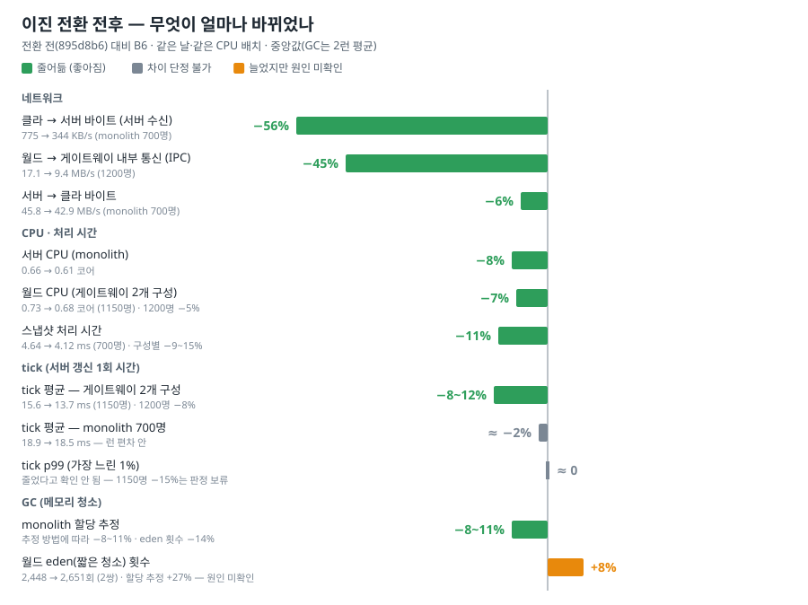

| 무엇 | 결과 |
|---|---|
| 바이너리 패킷 | 1개(위치 갱신만) → **71개 전부** (protoVersion 2 → 11) |
| 이동 입력 | 클릭 이동 요청(MOVE_TO) **초당 8회 제한** — 정상 클라는 닿지 않음 · 키보드 이동 **벽·맵 경계 충돌** |
| 네트워크 | 클라 → 서버 −56% · 월드 → 게이트웨이 내부 통신(IPC) −45% · 서버 → 클라 −6% |
| CPU · 처리 시간 | 서버 CPU −5~8% · 스냅샷 단계 −9~15% · tick 평균은 게이트웨이 2개 구성 −8~12%, monolith −2%(런 편차 안) |
| tick 꼬리(p99) · GC | p99는 줄었다고 확인 안 됨(런 편차 안, 1150명 −15%는 판정 보류) · monolith 할당 −8~11%·eden −14%, 월드 eden은 줄지 않음 → 할당원 찾기가 다음 과제 |
| 품질 | B6 코드 커밋(`1eea6a6`) 기준 전체 시험 실패 0 — 서버 단위 2,537 · 회귀 12 · 통합 103 · 클러스터 14 · Unity EditMode 48 · PlayMode 2(시험 수) |

---

## 1. 왜 시작했나

**직전 작업 — GC 페이서(10-11).** 서버가 느려지는 순간(tick 꼬리)의 원인은 tick 도중에 끼어드는 GC(메모리 청소)였다. 그래서 tick 사이 쉬는 시간에
GC를 미리 요청하는 장치를 넣었다. monolith는 p99가 26.1 → 23.0 ms로 좋아졌지만, 월드 서버(게이트웨이 2개 구성)는 그대로였다. 월드의 남은 꼬리 원인은
찾지 못했다.

**왜 이동 입력을 의심했나.** 같은 게임 로직을 혼자 돌린 벤치에서는 짧은 청소(eden)가 약 26 tick(≈1.3초)마다 1번이었다. 실서버에서는 초당 약 19번으로
수십 배 잦았다. 벤치에 없는 것은 클라 입력 수신이다. 그래서 접속자마다 초당 20번 오는 INPUT_CMD(키보드 이동 입력)를 JSON 문자열로 파싱하며 생기는
쓰레기가 1순위 용의자가 됐다. 설계 문서에도 "Phase D step 2 — 전체 바이너리 + 4바이트 LE 헤더"가 이미 계획으로 있었다.

**함께 받은 요청** — "초당 이동 입력 제한이 너무 널널한가": 웹 조사로 다른 게임과 비교했다.

시작 전에 정한 것(진행 중 재논의 없음):

| 항목 | 결정 |
|---|---|
| 바이너리 전환 범위 | 단계형 **전체** — 스키마 없던 자유 형식 패킷까지 스키마화하고, 마지막에 JSON 경로 삭제 |
| 헤더 | 6바이트 BE → **4바이트 LE** `[길이 u16][id u16]`, 구버전 클라는 감지해 "업데이트 필요"로 거절 |
| MOVE_TO | 연결당 **초당 8회 · 버스트 8**, 넘치면 최신 1건만 보류, 사망 중 무시 |
| 벽 통과 | 고친다(서버 + 클라 예측 같은 규칙) |
| 리뷰 | 핵심 단계(헤더 · 클라 → 서버 · 자유 형식 스키마화)는 상위 AI 리뷰어(Fable) + 보안 리뷰, 나머지는 기본 리뷰어(opus) |

---

## 2. 이동 입력 검토 (Phase M)

### 2.1 얼마나 보내고, 얼마나 허용하나

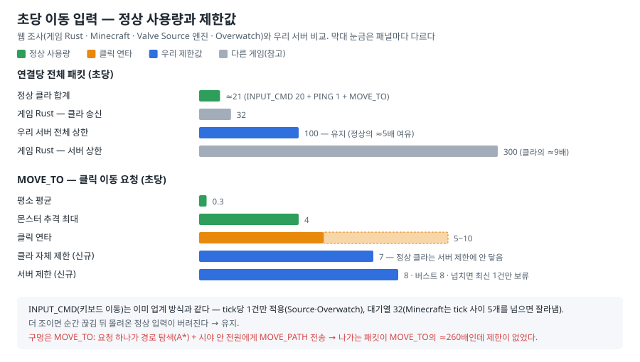

| 기준 | 내용 |
|---|---|
| 게임 Rust(Facepunch) | 클라 송신 32/s, 서버 상한 300/s(약 9배 여유) |
| Minecraft | tick 사이 이동 패킷이 5개를 넘으면 잘라낸다 |
| Source 엔진(Valve) · Overwatch | 입력은 tick당 1개만 적용, 중복·재전송은 허용 |
| 우리 서버(검토 전) | 연결당 전체 100/s 하나, INPUT_CMD는 tick당 1건 적용 · 대기열 32, **MOVE_TO는 종류별 제한 없음** |

- **INPUT_CMD는 그대로 둔다.** 이미 업계 방식과 같다. 더 조이면 순간 끊김 뒤에 몰려온 정상 입력을 버리게 된다.
- **구멍은 MOVE_TO였다.** 클릭 한 번이 경로 탐색(A*)을 돌리고, 시야 안 전원에게 이동 경로(MOVE_PATH)를 보낸다. 그래서 나가는 패킷이 받은 MOVE_TO의
  약 260배가 되는데 종류별 제한이 없었다. 죽은 상태에서도 처리됐다.

### 2.2 MOVE_TO 속도 제한

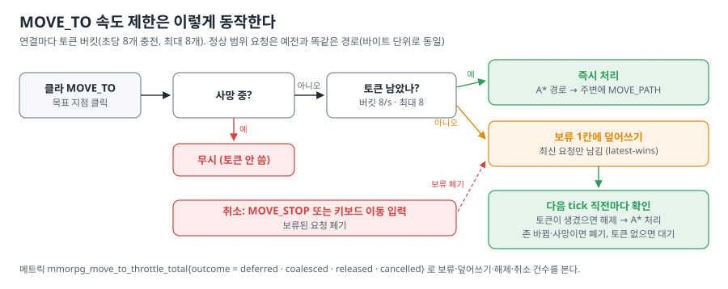

- 연결마다 토큰 버킷을 둔다(초당 8개 충전, 최대 8개). 토큰이 있으면 예전과 **바이트까지 똑같이** 즉시 처리한다.
- 토큰이 없으면 보류 칸 1개에 **최신 요청만** 남긴다(latest-wins). 다음 tick 직전마다 확인해 토큰이 생기면 처리한다. 그전까지는 최신 1건만 대기한다.
- 죽은 상태면 무시한다. 정지(MOVE_STOP)나 키보드 이동이 오면 보류를 버린다.
- 클라도 스스로 초당 7회로 제한한다. 그래서 정상 클라는 서버 보류까지 가지 않는다.

### 2.3 키보드 이동 벽 통과 수정

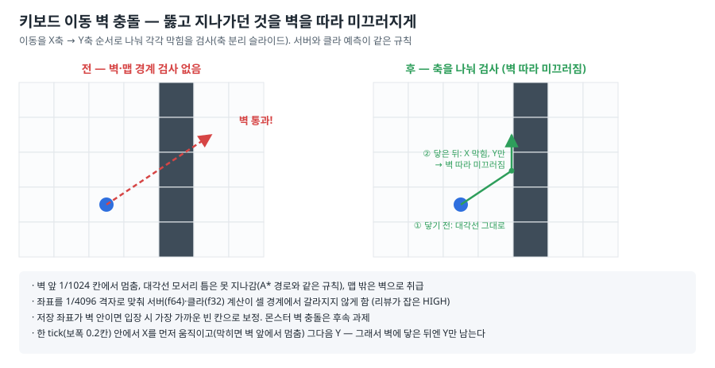

- 키보드(WASD) 이동에는 벽·맵 경계 검사가 아예 없어서 벽을 뚫고 맵 밖으로 나갈 수 있었다. 클릭 이동은 경로 탐색을 거치므로 괜찮았다.
- 한 tick의 이동을 X → Y 순서로 나눠 축마다 막힘을 검사한다. 벽에 비스듬히 밀면 닿기 전까지는 대각선으로 가고, 닿은 뒤에는 **벽을 따라 미끄러진다**.
  서버(TS)와 클라 예측(C#)이 같은 규칙을 쓰고, 교차 언어 골든 시험이 두 결과가 같은지 확인한다.
- 리뷰에서 HIGH가 하나 나왔다. 서버(f64)와 클라(f32)가 셀 경계에서 다른 칸으로 판정할 수 있었다. 좌표를 1/4096 격자에 맞춰 해결했다.

---

## 3. 바이너리 전환 (B0 ~ B6)

### 3.1 JSON과 바이너리는 무엇이 다른가

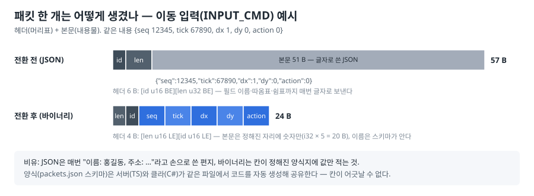

JSON은 필드 이름과 따옴표·쉼표까지 매번 글자로 보낸다. 바이너리는 "몇 번째 칸에 무엇"을 스키마(`shared/schema/packets.json`)가 정하고 값만 보낸다.
그 스키마에서 서버(TypeScript)와 클라(C#) 코드를 **자동 생성**하므로 양쪽이 어긋날 수 없다.

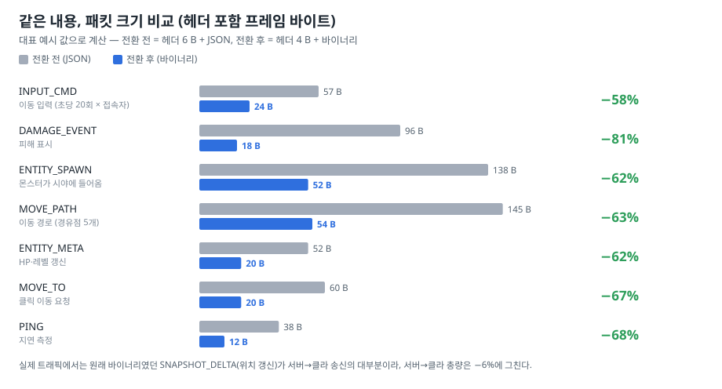

그림의 예시 7종(숫자 위주)에서는 같은 내용이 **58~81% 작아진다**. 문자열이 많은 패킷(채팅 등)은 필드 이름만 빠지므로 덜 줄어든다. 그런데 실제 서버 → 클라 총량은 6%만 줄었다. 송신의 대부분이 원래부터 바이너리였던 위치
갱신(SNAPSHOT_DELTA)이기 때문이다. 반대로 클라 → 서버는 거의 전부가 JSON이었으므로 절반 넘게 줄었다.

### 3.2 어떤 순서로 바꿨나

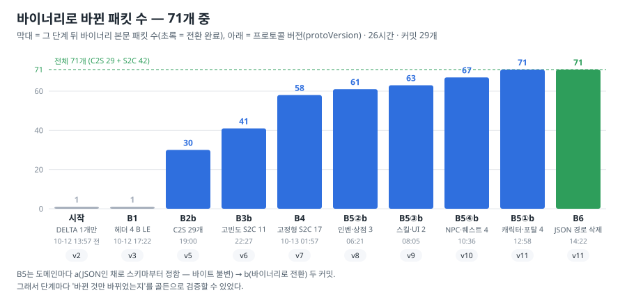

B3·B5 단계 이름의 **a**는 "JSON인 채로 스키마부터 정하기(바이트 불변)", **b**는 "바이너리로 바꾸기"다(B2는 a = 시간 필드 숫자화, b = 클라 → 서버
전환, c = 수신 방어). B5의 ①~④는 도메인 번호다.
실제로는 ② → ③ → ④ → ① 순서로 진행했다. ②는 검증 장치가 이미 갖춰져 있어 먼저 했고, ①은 기존 JSON 대표 시험이 몰려 있어 마지막에 했다
(시험을 두 번 옮기지 않으려고).

| 단계 | 시각 | 한 일 | protoVersion |
|---|---|---|---|
| Phase M | 10-12 13:57 | MOVE_TO 제한 + 키보드 벽 충돌 | — |
| B0 준비 (5커밋) | 14:34 ~ 17:14 | 프레임 헤더를 한 곳에서 정의, 스키마 → TS·C# 코덱 자동 생성, 송신 함수 타입화(잘못된 필드는 컴파일 오류), 교차 언어 골든 | 2 (와이어 불변) |
| H1 | 16:48 | 프레임 64 KB 상한 + 큰 위치 갱신 자동 분할 | 2 |
| B1 | 17:22 | 헤더 6 B BE → 4 B LE, 구버전 클라 감지·거절 | 3 |
| B2 (a · b · c) | 17:48 ~ 20:22 | 시간 필드 숫자화 → **클라 → 서버 29개 전부** 바이너리 → 깨진 패킷 반복 시 강제 종료·위험 문자 차단 | 4 · 5 |
| B3 (a · b) | 21:10 · 22:27 | 자주 오는 서버 → 클라 11개(스폰·피해·경로·채팅 등) | 6 |
| B4 | 10-13 01:57 | 나머지 고정형 17개 + 송신 인코드 방어층(잘못된 값이면 그 패킷만 버림) | 7 |
| B5-0 · B5-P | 03:40 · 04:46 | 서버 → 클라 본문 골든 추가, DB 값 범위 정규화 | 7 |
| B5 ② ③ ④ ① | 05:28 ~ 12:58 | 남은 JSON 13개(스키마 없던 12개 + JSON 문자열을 싣던 CHAR_LIST) — 인벤·상점 / 스킬·UI / NPC·퀘스트 / 캐릭터·포탈 | 8 ~ 11 |
| B6 | 14:22 | JSON 본문 경로 삭제 + "JSON 다시 쓰면 CI 실패" 가드 | 11 |

**왜 이렇게 잘게 나눴나.** 한 번에 바꾸면 무엇이 깨졌는지 알 수 없다. 그래서 단계마다 "바뀌어야 할 것만 바뀌었는지"를 아래 안전장치로 기계적으로
확인했다. 예를 들어 헤더 단계에서는 헤더가 6 → 4바이트가 됐으니 "모든 세션의 바이트가 정확히 프레임 수 × 2만큼만 줄었다"를 확인했다. 스키마화(a)
단계에서는 "바이트가 1비트도 안 바뀌었다"를 확인했다.

### 3.3 안 깨뜨리고 바꾸는 장치

| 장치 | 하는 일 |
|---|---|
| 와이어 특성화 골든 | 정해진 시나리오에서 세션마다 실제로 나간 바이트의 해시. 단계 종류별로 바뀌어도 되는 지표가 정해져 있다 |
| S2C 본문 미니 골든 (B5-0) | 실물 데이터로 서버 → 클라 13개 패킷 본문을 고정 |
| 교차 언어 골든 | 참조 구현 · 서버(TS) · 클라(C#) 세 코덱이 같은 바이트를 내는지 사례 수천 개로 대조 |
| lock 파일 | 패킷 레이아웃이 바뀌었는데 protoVersion을 안 올리면 코드젠이 실패 |
| 구버전 클라 거절 | 옛 헤더·옛 버전 클라는 첫 프레임으로 감지해 "업데이트 필요"(KICK 1)로 안내 |
| 송신 인코드 방어층 | 범위 밖 값이 와도 그 패킷만 버리고 tick은 계속(메트릭 `mmorpg_net_encode_error_total`, 0이 정상) |
| JSON 재도입 CI 가드 | 와이어 코드에 `JSON.parse`·`JSON.stringify`가 허용 목록 밖에서 생기면 시험 실패 |
| 게이트 · 리뷰 | 커밋마다 전체 시험(서버 단위 · 회귀 · 통합 · 클러스터), C#을 바꾼 커밋은 Unity EditMode·PlayMode까지. 리뷰 지적은 반박 검증 뒤 반영 |

### 3.4 전환하면서 같이 고친 것

- **레벨업 패킷 소실 틈** — 준비 단계(H1)에서 새 헤더에 맞춰 프레임 본문을 64 KB로 묶은 뒤, 바이너리 전환(B5①b) 전까지는 한 번에 약 76레벨
  이상 오르면 레벨업 JSON이 64 KB를 넘어 버려지는 틈이 있었다. 바이너리로 바꾸면서 닫았다(GM으로 1 → 300레벨 올리는 회귀 시험 추가).
- **데이터 상한 강제** — 스킬·NPC·퀘스트·상점·아이템 이름과 개수가 바이너리 칸 상한을 넘으면 서버 부팅 때 거부한다. 런타임에 패킷이 조용히
  버려지지 않게 하려는 것이다.
- **DB 값 범위 정규화(B5-P)** — DB에 이상한 값(무한대 좌표, HP > 최대 HP 등)이 있어도 메모리에 올릴 때 바로잡는다. 좌표가 깨졌으면 존 시작점으로 보낸다.
- **깨진 패킷 반복 시 강제 종료, 채팅 위험 문자 차단(B2c)** — 디코드에 계속 실패하는 연결은 끊고, 화면을 깨뜨리는 제어 문자·보이지 않는 문자는 채팅에서 막는다.

---

## 4. 성능 측정 결과

**방법.** WSL2에서 같은 날 같은 시간대에 전환 전(`895d8b6`, B1 직전)과 전환 후(B6)를 번갈아 돌렸다. 시나리오는 spread(봇이 맵에 고르게 퍼져 계속 이동)다.
구성은 두 가지다.
- **monolith**: 서버 프로세스 1개, 700명.
- **게이트웨이 2개 구성**: 월드 1 + 게이트웨이 2, 1150 · 1200명.

서버는 전용 CPU에 고정했고 런마다 30초를 유지했다.

측정 PC에는 코드 사본(체크아웃)을 두 개 둔다. **A**(`~/mmorpg-a`)와 **B**(`~/mmorpg`)를 번갈아 돌린다. 최종 측정은 네 묶음, 38런이다.
1. **대조** — 같은 커밋을 A·B 양쪽에서 돌려 사본 차이가 없는지 본다.
2. **전후 비교** — A = 전환 전, B = B6. 아래 그림 대부분이 이것이다.
3. **GC 로그 런** — 한 쌍을 더 돌렸다.
4. **재현** — 예전 측정의 CPU 배치를 일부러 다시 만든다(§4.1).

38런 모두 전원 접속, 강제 종료 0, 20 Hz 유지였다. 중간에도 B2b(클라 → 서버 전환 직후)와 B3b(자주 오는 서버 → 클라 전환 직후)에서 같은 방식으로 쟀다.

### 4.1 먼저 — 예전 측정의 CPU 배치를 바로잡았다

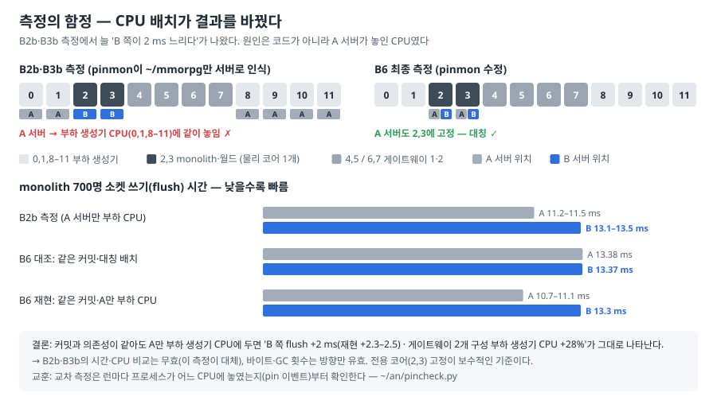

- 중간 측정(B2b · B3b)에서는 매번 같은 이상이 나왔다. monolith에서는 B 쪽 소켓 쓰기(flush)가 2 ms 느렸고, 게이트웨이 2개 구성에서는 부하 생성기
  CPU가 25~28% 높았다. 코드로는 설명되지 않았다.
- 원인은 CPU 고정 스크립트(pinmon)였다. 이 스크립트는 `~/mmorpg` 사본만 서버로 알아봤다. 그래서 A 서버는 전용 코어 대신 **부하 생성기 CPU에 같이
  놓였다**.
- 최종 측정에서 두 가지로 확인했다.
  1. 같은 커밋·같은 의존성을 같은 배치로 돌리면 차이가 없다.
  2. A만 부하 생성기 CPU에 두면 "B 쪽 flush +2 ms" 현상이 그대로 다시 나타난다.
- 그래서 B2b · B3b의 시간 · CPU 비교는 무효로 하고, 아래 결과(배치를 바로잡은 최종 측정)로 대체한다. 바이트 감소(B2b 수신 −54% · B3b IPC −48%)와
  "eden 횟수가 줄지 않았다"는 결론은 배치 영향이 작아 유지한다. 할당 추정(B2b −20% · B3b −23%)은 방향을 확정하지 않는다.

### 4.2 네트워크

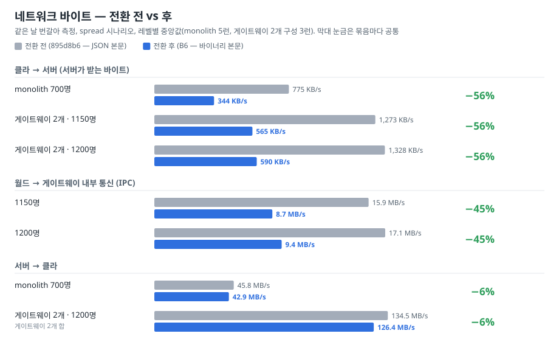

- 클라 → 서버는 거의 전부 JSON이었던 만큼 절반 넘게 줄었다.
- 월드 → 게이트웨이는 자주 오는 서버 → 클라 패킷이 바이너리가 되면서 절반 가까이 줄었다.
- 서버 → 클라는 원래 바이너리인 위치 갱신이 대부분이라 6%에 그쳤다(§3.1).

### 4.3 CPU와 처리 시간

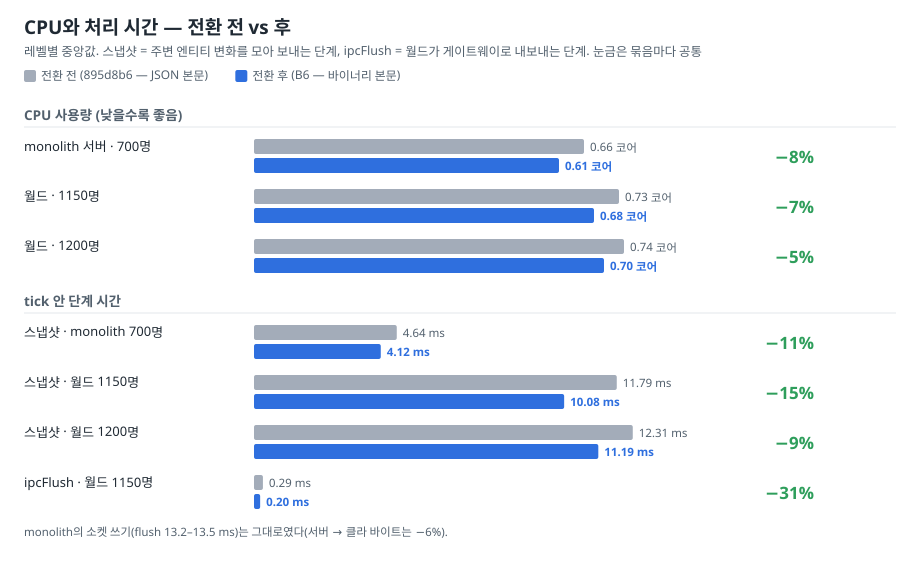

- **스냅샷 단계가 줄어든 이유**: 몬스터·플레이어가 시야에 들고 날 때 보내는 패킷(ENTITY_SPAWN·DESPAWN)이 JSON 직렬화를 거치지 않는다. 프레임도 작아져
  복사할 바이트가 줄었다. 그 사이 스냅샷 경로에 다른 최적화는 없었다.

### 4.4 tick 시간

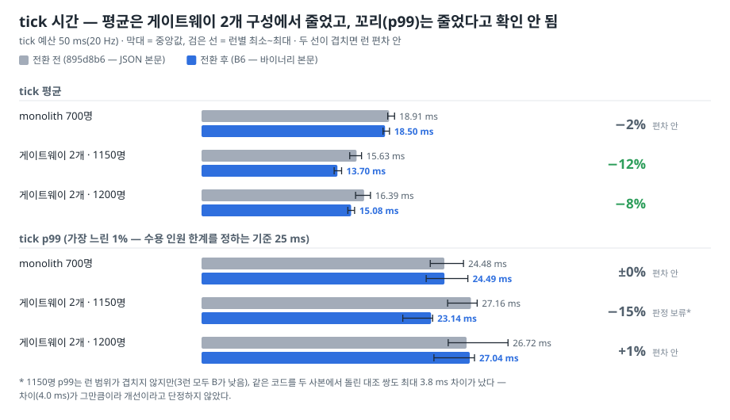

- **평균**: 게이트웨이 2개 구성은 1150명 −12%, 1200명 −8%로 줄었다(전후 런 범위가 겹치지 않음). monolith(−2%)는 런 편차 안이다.
  monolith는 tick 18.5 ms 중 약 13 ms가 클라 소켓 쓰기(flush)인데, 여기는 바뀌지 않았다(§4.3).
- **꼬리(p99)**: 이 프로젝트는 p99 25 ms를 수용 인원 한계의 기준으로 쓴다. monolith 700명과 1200명은 차이가 런 편차 안이다. 1150명은 3런 모두 B가
  낮았지만(−15%, 4.0 ms), 같은 코드를 두 사본에서 돌린 대조 쌍도 최대 3.8 ms 차이가 나서 개선이라고 단정하지 않았다.
- 꼬리는 주로 tick 도중 끼어드는 GC가 만든다(monolith에서 확인. 월드 원인은 미확인 — eden 정지가 후보).

### 4.5 GC (메모리 청소)

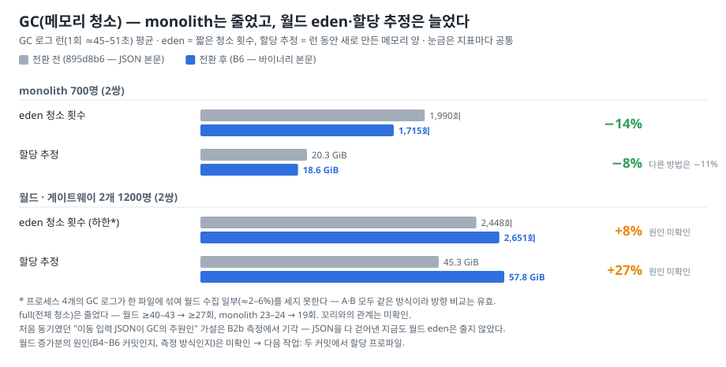

- **두 지표의 뜻**: eden 횟수는 짧은 청소가 몇 번 돌았는지, 할당 추정은 그동안 새로 만든 메모리 양이다. 청소 한 번이 치우는 양이 달라지면 둘은
  따로 움직인다.
- **monolith**: 할당 추정이 8~11%(추정 방법에 따라 다름), eden 횟수가 14% 줄었다.
- **월드**: eden 횟수와 할당 추정이 오히려 늘었다(2쌍 모두). 전체 청소(full)는 월드 ≥40–43 → ≥27회, monolith 23–24 → 19회로 줄었지만
  꼬리와의 관계는 확인하지 못했다.
- **판정 보류**: 이번(B6)에는 월드 할당이 늘었지만, 예전 B2b · B3b 측정에서는 같은 방법으로 −20% · −23%였다. 두 측정의 방향이 반대다. 판정을
  보류한 이유는 두 가지다.
  - 예전 측정은 비교 대상 서버가 잘못된 CPU에 놓였었다(§4.1).
  - 할당 추정은 GC 로그의 힙 크기로 계산한다. 그래서 바이너리 버퍼와 JSON 문자열이 다르게 잡힐 수 있다.

  늘어난 몫이 코드 탓인지 측정 탓인지는 아직 가르지 못했다. 계산 방법은 이렇다. 수집당 할당은 다른 프로세스 로그가 섞이지 않은 줄에서만 표본을 잡고,
  거기에 전체 수집 수를 곱했다(월드 수집 수는 하한).
- **확실한 것**: 프로토콜 JSON은 월드 GC의 주원인이 아니다. 다음 작업은 전환 전 · 후 두 커밋에서 **할당 프로파일**을 떠서 실제 할당원을 찾는 것이다.
- **후속(같은 날, Bun 1.4.3)**: 서버 런타임을 Bun 1.4.3으로 바꾸자 eden 수집이 91~95% 줄었다 — "eden ≈19회/초"의 유력 원인은 1.3.x
  런타임의 GC 샘플러다. 1.4.3으로 전환 전 · 후를 다시 재면 월드 할당 추정은 바이너리 쪽이 오히려 21~38% 적어, 위 증가분은 1.4.3에서는
  재현되지 않는다(원인은 가설 — [perf-baseline.md](../perf-baseline.md) "Bun 1.4.3 전환").

### 4.6 측정이 확인한 것

| 가설 | 결과 |
|---|---|
| 이동 입력 JSON 파싱이 월드 GC의 주원인 | **기각** — 클라 → 서버를 바이너리로 바꾼 뒤(B2b)에도 eden 횟수가 줄지 않음(월드는 오히려 +7%) |
| 자주 오는 서버 → 클라 JSON 문자열화가 원인 | **기각** — B3b에서도 줄지 않음(월드 접속자당 +13%) |
| 바이너리로 바꾸면 바이트가 준다 | **맞음** — 클라 → 서버 −56%, 월드 → 게이트웨이 −45%, 서버 → 클라 −6% |
| 바이너리로 바꾸면 tick 꼬리가 준다 | **확인 안 됨** — p99 차이가 런 편차 안(1150명 −15%는 보류). 꼬리 후보인 월드 eden이 줄지 않았다 |
| "B 쪽 flush +2 ms"는 코드 문제 | **아님** — CPU 배치 차이(재현으로 확인) |

---

## 5. 남은 과제

| 분류 | 과제 |
|---|---|
| 성능 (다음) | 월드 할당원 찾기 — `895d8b6`·B6 두 커밋에서 할당 프로파일. 그 밖에 스냅샷 SPAWN/DESPAWN 공유, 실제 네트워크 카드(NIC) 측정, 클라 자동 재접속 |
| 이동 | 몬스터 벽 충돌(스폰 #1 (40,30)이 벽 칸 안이라 데이터부터 수정), 부하 생성기에 WASD 이동 추가, e2e 시험 tick 루프에 MOVE_TO 보류 해제 배선 |
| 패킷 형태 다듬기 (각각 버전 올림) | CHAR_STATS_FULL의 클라 미사용 필드, CHAR_LEVEL_UP.statDeltas, 퀘스트 코드값 enum화, SKILL_LIST.learned 중복, QUEST_LIST.completed 증가 대비, NPC 대화 평탄화 |
| 와이어 무관 | 클라 패킷 구독자별 중복 디코드, 클라 tick 추정값 int 넘침, 손상된 UI 설정 행 예외, 퀘스트 마커 diff 캐시의 `JSON.stringify`, 재송신 CHAR_STATS_FULL의 HP·MP 일시 되돌아감, skill id 0 허용(퀵슬롯 빈칸과 겹침), bodyOf C# 인코드의 하위 class 요구 |
| 시험 · 기타 | S2C 미니 골든을 계속 둘지 결정 |
| 세션 리뷰에서 나온 것 (ADR 밖) | 인벤 최대 칸 와이어 상한 가드, 간헐 실패 `e2e-combat` Flow 4 |

---

## 6. 용어 풀이

| 용어 | 뜻 |
|---|---|
| tick | 서버가 게임 상태를 한 번 갱신하는 단위. 20 Hz라 50 ms마다 1번이고, 50 ms 안에 끝나야 밀리지 않는다 |
| p99 | 가장 느린 1%의 경계값. 평균보다 "가끔 버벅이는 순간"을 잘 보여준다. 이 프로젝트는 tick p99 25 ms를 수용 인원 한계로 본다 |
| C2S / S2C | 클라 → 서버 / 서버 → 클라 패킷 |
| 와이어 · 프레임 | 와이어 = 실제로 네트워크에 나가는 바이트. 프레임 = 헤더 + 본문으로 된 패킷 한 덩어리 |
| LE / BE | 여러 바이트로 된 숫자를 낮은 자리부터(LE, 리틀 엔디언) 또는 높은 자리부터(BE) 쓰는 순서. 요즘 CPU는 대부분 LE라 변환이 필요 없다 |
| u16 · i32 · f32 · f64 | 부호 없는 16비트 정수 · 부호 있는 32비트 정수 · 32/64비트 실수 |
| 스키마 · 코드젠 | 스키마 = 패킷마다 어떤 칸에 무엇이 오는지 적은 정의(`packets.json`). 코드젠 = 그 스키마에서 TS·C# 코드를 만드는 자동 생성기 |
| protoVersion | 프로토콜 버전. 와이어 형식이 바뀌면 올리고, 버전이 다른 클라는 접속 때 거절한다 |
| 골든 시험 | 정답 출력을 파일로 저장해 두고, 코드를 바꾼 뒤 같은지 비교하는 시험 |
| monolith | 서버 프로세스 1개가 접속·게임 로직을 다 맡는 기본 구성 |
| 월드 · 게이트웨이 · IPC | 확장 구성. 게이트웨이가 클라 소켓을 맡고 월드가 게임 로직을 맡는다. 둘 사이 통신이 IPC다. "N=2"는 게이트웨이 2개 구성 |
| 런 | 부하 시험 1회 실행. 같은 조건도 런마다 조금씩 흔들린다 |
| A · B, 체크아웃 | 측정 PC의 코드 사본 두 개. 번갈아 돌려 비교한다(최종 측정에서 A = 전환 전, B = B6) |
| GC · eden · full | 안 쓰는 메모리를 치우는 청소. eden은 새로 만든 것만 보는 짧은 청소, full은 전체 청소 |
| 할당 | 새 메모리를 만드는 것. 많이 만들수록 GC가 자주 돈다 |
| GC 페이서 | tick 사이 여유 시간에 GC를 미리 요청해 tick 도중 GC를 줄이는 장치(직전 작업) |
| 토큰 버킷 | 일정 속도로 채워지는 토큰을 하나씩 써야 요청이 처리되는 속도 제한 방식 |
| latest-wins | 처리를 미룬 요청이 여러 개 오면 마지막 것만 남기는 방식 |
| flush | 모아 둔 송신 데이터를 소켓에 실제로 쓰는 단계 |
| 스냅샷 | 매 tick 주변 엔티티의 변화를 모아 클라에 보내는 단계 |
| spread | 봇이 맵 전체에 고르게 퍼져 계속 이동하는 부하 시나리오 |
| pinmon | 측정 중 서버·부하 생성기 프로세스를 정해진 CPU에 고정하는 측정 PC 스크립트 |

주요 패킷:

| 패킷 | 뜻 |
|---|---|
| INPUT_CMD | 키보드 이동 입력. 클라가 매 tick(초당 20번) 보낸다 |
| MOVE_TO / MOVE_PATH / MOVE_STOP | 클릭 이동 요청 / 서버가 주변에 알리는 이동 경로 / 정지 |
| SNAPSHOT_DELTA | 매 tick 주변 엔티티 위치 갱신. 전환 전부터 바이너리였다 |
| ENTITY_SPAWN / ENTITY_DESPAWN | 엔티티가 시야에 들어옴 / 나감 |
| KICK | 서버가 연결을 끊으며 보내는 이유 코드(1 = 업데이트 필요 등) |

---

## 부록 A. 커밋 목록 (이력 순서)

| 시각 | 커밋 | 내용 |
|---|---|---|
| 10-12 13:57 | `bb405cd` | MOVE_TO 연결당 속도 제한 + 키보드 이동 벽·경계 충돌 |
| 14:34 | `2bd848b` | 프레임 헤더 단일 정의 + 프로토콜 버전 단일 소스 (와이어 불변) |
| 15:51 | `2264b79` | 스키마 v2 + 생성 바이너리 본문 코덱 (와이어 불변) |
| 16:09 | `f13a016` | 타입화 송신 — 방향·필드 위반을 컴파일 오류로 |
| 16:24 | `2698cd8` | 이진 전환 프리플라이트 — 골든 지표 + 형태 검사 |
| 17:14 | `f1899ed` | C# 바이너리 코덱 생성 + 교차 언어 골든 |
| 16:48 (17:14 재커밋) | `895d8b6` | 프레임 64 KB 상한 + SNAPSHOT_DELTA 분할 — 측정 기준점 "전환 전" |
| 17:22 | `06018bb` | B1 헤더 v2(4 B LE) + 구 v1 클라 거절 — protoVersion 3 |
| 17:27 | `30156e2` | 진행 메모리 기록 |
| 17:48 | `1281a45` | B2a 시간 필드 문자열 → 숫자 — protoVersion 4 |
| 19:00 | `ee0821f` | B2b 클라 → 서버 29개 바이너리 — protoVersion 5 |
| 19:32 | `a751ff1` | B2b 측정 — 입력 경로 할당 가설 기각 |
| 20:22 | `5bd2197` | B2c 수신 사전 판정 · 디코드 실패 강제 종료 · 위험 문자 차단 |
| 21:10 | `53280f9` | B3a 경로·스킬 효과 스키마화 · 엔티티 종류 enum (JSON 상태) |
| 22:27 | `4575747` | B3b 자주 오는 서버 → 클라 11개 바이너리 — protoVersion 6 |
| 10-13 00:31 | `33a5693` | B3b 측정 — IPC −48% · 배치 비대칭 발견 |
| 01:57 | `3dc7365` | B4 고정형 서버 → 클라 17개 바이너리 — protoVersion 7 |
| 03:40 | `270a630` | B5-0 서버 → 클라 13개 본문 골든 |
| 04:46 | `a55d768` | B5-P DB 적재 경계 정규화 |
| 05:28 · 06:21 | `8b19b0a` · `aee6e23` | B5② 인벤·상점 스키마화 → 바이너리 — protoVersion 8 |
| 07:18 · 08:05 | `21db875` · `fd69de4` | B5③ 스킬·UI 설정 — protoVersion 9 |
| 09:20 · 10:36 | `4486362` · `dd8b13f` | B5④ NPC 대화·퀘스트 — protoVersion 10 |
| 11:41 · 12:58 | `e1c71bc` · `914228d` | B5① 캐릭터·포탈 + CHAR_LIST 형태 변경 — protoVersion 11 |
| 14:22 | `1eea6a6` | B6 JSON 본문 경로 삭제 + CI 가드 |
| 15:37 | `7f3a93e` | B6 최종 측정 — 전환 전 ↔ B6 · 배치 비대칭 재현 |

## 부록 B. 원자료와 그림

- 측정 원자료는 측정 PC WSL에 있다. `~/perf-b2b` · `~/perf-b3b` · `~/perf-b6`(런별 결과 · GC 로그 · CPU 고정 기록), 분석 스크립트는 `~/an/`.
- 수치의 정본은 [perf-baseline.md](../perf-baseline.md)의 해당 절이다. 이 문서의 그림은 그 절의 중앙값(GC는 런 평균)을 옮긴 것이다.
- 패킷 크기(§3.1)는 대표 예시 값으로 계산했다. 전환 후는 현재 코덱(`tests/helpers/wire.ts encodeBody`), 전환 전은 그때 서버가 싣던 필드 그대로
  `JSON.stringify`했다. 실제 크기는 값에 따라 달라진다.
- 그림은 같은 폴더의 생성기로 다시 만든다: `bun run docs/reports/img/binary-transition/gen.ts docs/reports/img/binary-transition`. 수치를 고칠 때는
  생성기 안의 데이터를 바꾼다.
