# Bun 1.4.3 전환 — 결과 정리

> 2026-10-13(후속 측정 2026-10-14) · 브랜치 `bun-to-cpp-server` · 비교 기준 = 마지막 기준(이진 전환 B6 이후 코드, 서버 런타임 Bun 1.3.13)
> 자세한 기록: [perf-baseline.md](../perf-baseline.md) "Bun 1.4.3 전환"·"Bun 1.4.3 — 수용 인원·GC 페이서·소크" · 앞 보고서 [이진 전환 결과 정리](binary-transition-2026-10.md)
> 처음 보는 용어는 [9. 용어 풀이](#9-용어-풀이)에 모아 두었다.

## 요약

**서버 런타임을 Bun 1.3.13에서 1.4.3으로 올리자, 코드는 그대로인데 같은 인원을 받는 서버가 눈에 띄게 가벼워졌다. 게이트웨이 2개 구성은
이 측정 PC에서 받을 수 있는 인원도 약 1/4 늘었다.**

- CPU: 같은 부하에서 monolith 서버 **−23%**, 월드 서버 **−41%**.
- tick: 게이트웨이 2개 구성에서 평균 −24%, 느린 1%(p99) **−23~29%**.
- GC: 짧은 청소(eden)가 **1/10 이하**로 줄었다(monolith 런당 ≈1,700 → ≈150회, 초당 약 38 → 3회). 이진 전환 내내 줄지 않던 바로 그 GC다.
  유력 원인은 1.3.x 런타임의 GC 샘플러다.
- **수용 인원**(tick p99 25 ms를 넘는 인원 — 측정 PC가 한가할 때·페이서 8(당시 기본) 기준): 게이트웨이 2개 구성 ≈1,227 → **≈1,621명(+20~32%)**. monolith는
  ≈756 → ≈776명(+3%)으로 런 사이 흔들림 범위 안이라 **사실상 그대로**다 — monolith tick의 약 3/4인 소켓 송신(flush)은 그대로이고 1.4.3은
  나머지 1/4만 줄여(같은 인원 p99 −7~10%) 교차점이 거의 움직이지 않았다(5.1).
- **GC 페이서**(tick 사이에 GC를 미리 요청하는 이 서버의 장치): 1.4.3에서는 tick 이득이 측정되지 않고 짧은 청소(eden) 횟수만 2.5~2.7배로
  늘려서 **기본값을 끔으로 바꿨다**(5.2).
- **60분 연속 운전**(당시 기본 페이서 8): 메모리·GC 빈도가 일정하고 크래시·끊김이 없었다. tick p99는 후반이 약 2 ms 높았지만 쌓인 흔적은
  없다(원인 미확인 — 5.3).
- 기능: 전체 시험과 서버가 기대는 소켓·IPC 동작이 Windows·Linux 모두 1.3.13과 같다.

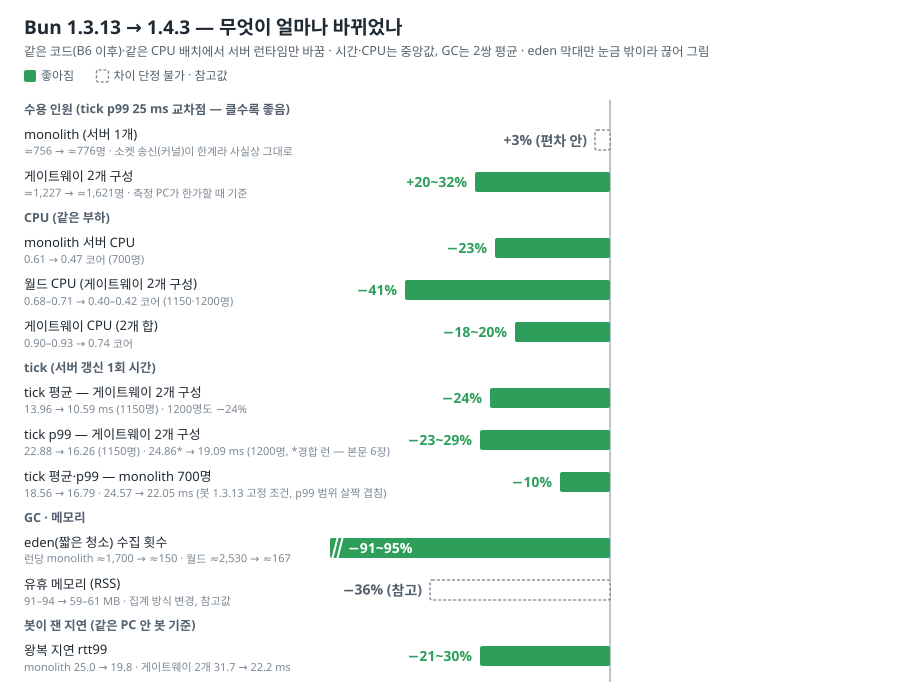

| 무엇 | 1.3.13 → 1.4.3 (같은 코드·같은 부하) |
|---|---|
| CPU | monolith 0.61 → 0.47 코어(−23%) · 월드 0.68–0.71 → 0.40–0.42(−41%) · 게이트웨이 2개 합 −18~20% |
| tick | 게이트웨이 2개 구성 평균 −24% · p99 −23~29% · monolith 평균·p99 −10% — 봇 쪽 런타임을 1.3.13으로 고정했을 때의 값(6장) |
| GC | eden −91~95%(런당 monolith ≈1,700 → ≈150회) · full은 monolith·월드 −21~27%, 게이트웨이 ≈12 → ≈3회 |
| 메모리(참고값) | 유휴 RSS 91–94 → 59–61 MB — 런타임이 메모리를 세는 방식이 바뀌어 버전 사이 직접 비교는 참고만(4.2) |
| 봇이 잰 지연 | 왕복(rtt99) −21~30% — 같은 PC 안 봇 기준, 실제 클라·네트워크는 재지 않음 |
| 기능 | 전체 시험·실소켓·IPC 동작 — Windows·Linux 모두 1.3.13과 같음 |
| 수용 인원 | 게이트웨이 2개 ≈1,227 → ≈1,621명(**+20~32%**) · monolith ≈756 → ≈776명(+3% — 런 편차 안, 사실상 그대로) — 측정 PC가 한가할 때·페이서 8(당시 기본) 기준 (5.1) |
| GC 페이서 | 이득 없음, 켜면 eden만 2.5~2.7배 — 그래서 **기본값을 8에서 0(끔)으로** (5.2) |
| 60분 연속 운전 (소크) | 당시 기본 페이서 8 — 메모리·GC 빈도 일정, 크래시·끊김 0. 새 기본(끔)으로는 소크하지 않았다 (5.3) |

---

## 1. 왜 올렸나

- 서버가 가끔 느려지는 순간(tick 꼬리, p99)은 주로 tick 도중에 끼어드는 GC가 만든다. 이 꼬리가 25 ms를 넘는 인원이 곧 수용 인원 한계다.
- 이진 전환 보고서의 결론은 "프로토콜 JSON을 걷어내도 월드 서버의 짧은 청소(eden)가 줄지 않는다 — 진짜 원인은 다른 곳"이었다.
- 마침 Bun 1.4(2026-08-20)가 런타임을 Zig에서 Rust로 다시 쓰면서 GC 동작을 크게 바꿨다. 최신 안정판은 1.4.3(2026-10-10)이다.
- 그래서 "런타임을 올리면 GC가 달라지는가"를 같은 코드로 재 봤다.

## 2. 무엇이 바뀌었나 — GC 샘플러

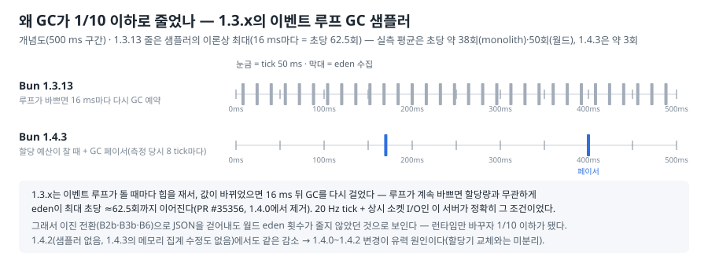

- 1.3.x는 이벤트 루프가 돌 때마다 힙 크기를 재고, 값이 바뀌었으면 16 ms 뒤 GC를 다시 예약했다. 루프가 계속 바쁘면 **할당량과 상관없이** eden이
  최대 초당 약 62.5회까지 이어진다(oven-sh/bun PR #35356, 1.4.0에서 제거).
- 이 서버는 20 Hz tick과 쉬지 않는 소켓 입출력으로 루프가 늘 바쁘다 — 정확히 그 조건이었다. 이진 전환에서 JSON을 걷어내도 월드 서버의 eden 횟수가
  줄지 않았던 이유가 이것이라는 설명이 측정과 맞는다(코드는 그대로 두고 런타임만 바꾸자 1/10 이하가 됐다).
- 1.4에는 그 밖에도 할당기 교체(mimalloc), Buffer 읽기·쓰기 최적화, 바이너리 버퍼(typed array) 메모리 집계 수정(1.4.3) 등이 들어 있다.

## 3. 어떻게 쟀나

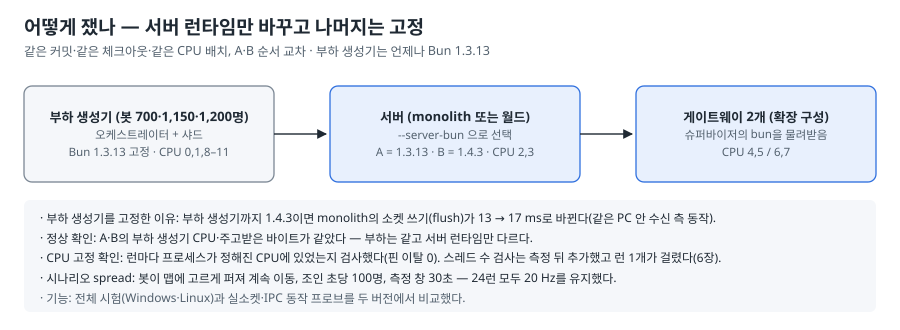

- **서버 런타임만 바꿨다.** 같은 커밋·같은 코드 사본·같은 CPU 배치에서 서버만 1.3.13(A)과 1.4.3(B)으로 번갈아 띄웠다. 봇을 돌리는 부하 생성기는
  언제나 1.3.13이다(부하 생성기 런타임이 바뀌면 그 자체로 서버 수치가 움직이기 때문 — 6장).
- **확인한 것**: A·B의 부하 생성기 CPU·주고받은 바이트가 같다(= 부하가 같다), 런마다 서버가 정해진 CPU에 있었다, 20 Hz를 유지했다.
- 구성: monolith(서버 1개) 700명, 게이트웨이 2개 구성(월드 1 + 게이트웨이 2) 1,150·1,200명. 시나리오는 spread(봇이 맵에 고르게 퍼져 계속 이동)다.
- 측정 PC WSL2(Linux). monolith 5런, 게이트웨이 2개 구성 인원별 3런, GC 기록 런 2쌍 — 24런 모두 전원 접속·강제 종료 0·20 Hz를 유지했다.
  시간·CPU는 접속이 끝난 뒤 30초 창에서, GC 횟수는 접속 구간을 포함한 런 전체(≈45–51초)에서 셌다.

## 4. 같은 부하에서의 결과

### 4.1 CPU와 tick

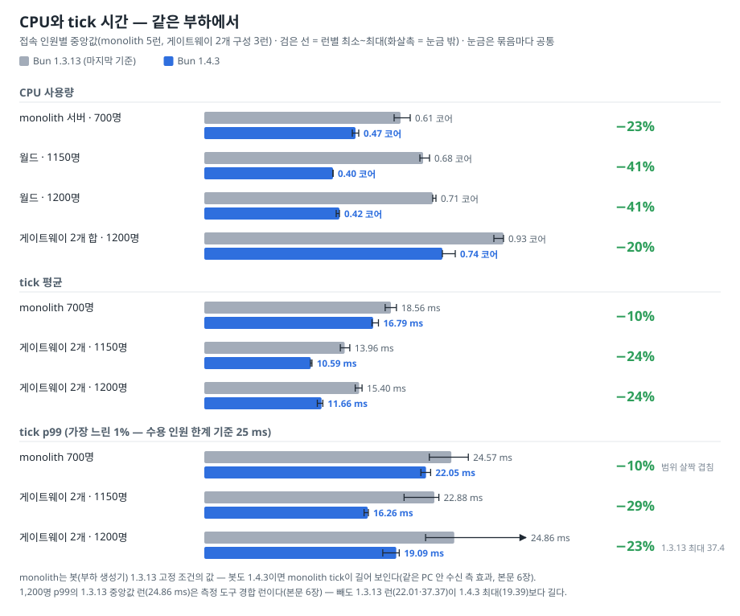

- 월드 서버 CPU가 약 40% 줄었다(0.68–0.71 → 0.40–0.42 코어). 게이트웨이 2개 구성은 tick 평균·p99 모두 런 범위가 겹치지 않을 만큼 줄었다
  (1,200명의 1.3.13 중앙값 런은 측정 도구 경합 런이다 — 6장. 그 런을 빼도 1.3.13 런(22.01·37.37 ms)이 1.4.3 최대(19.39 ms)보다 길다).
- monolith는 tick 평균이 −10%로 런 범위가 겹치지 않게 줄었다. p99도 중앙값은 −10%지만 런 범위가 조금 겹친다(1.3.13 최저 22.38 < 1.4.3 최고 22.51).
- 줄어든 곳은 주로 스냅샷 단계(−25~27%)다. monolith는 tick 18.6 ms 중 약 13 ms가 클라 소켓 쓰기(flush)인데, 이 부분이 거의 그대로(−3%)라
  전체로는 −10%에 그쳤다. GC 감소·할당기 교체 같은 1.4의 변경이 각각 얼마나 기여했는지는 나누지 않았다.

### 4.2 GC와 메모리

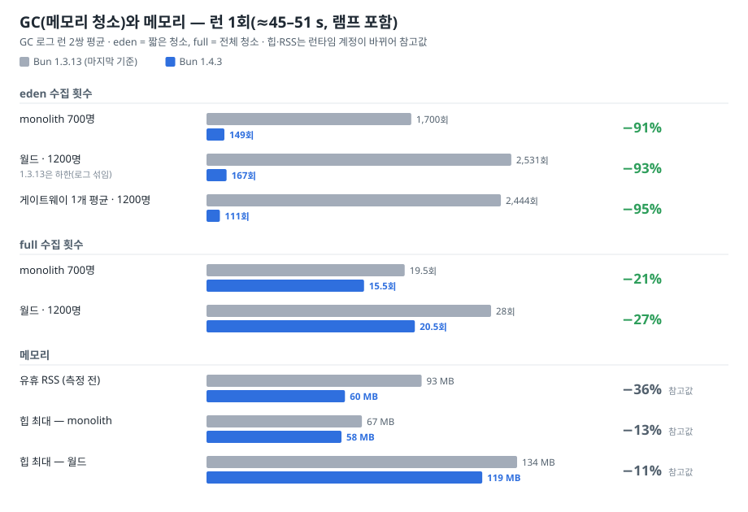

- eden(짧은 청소)이 런당 1,700회 → 149회(monolith), 2,531회 이상(로그가 섞여 하한) → 167회(월드)로 줄었다. 전체 청소(full)도 monolith·월드
  −21~27%, 게이트웨이는 ≈12 → ≈3회로 줄었다.
- 1.4.3에 남은 eden의 약 60%는 이 서버의 GC 페이서가 요청한 것이다(끄면 monolith 148 → 58회). 다시 맞춰 본 결과 1.4.3에서는 페이서 이득이 없어 기본값을 끔으로 바꿨다(5.2).
- 유휴 메모리(RSS)는 93 → 60 MB. 힙·RSS는 런타임이 메모리를 세는 방식이 바뀌어 버전 사이에는 참고값이다.

### 4.3 봇이 잰 지연

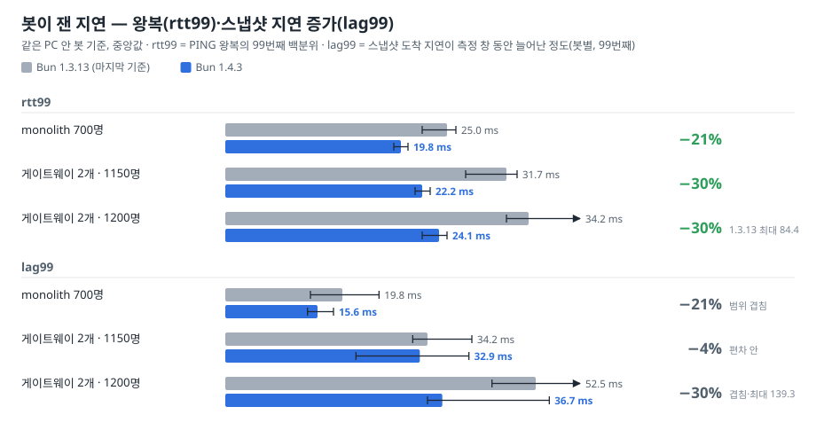

- 봇 기준 왕복 지연(rtt99)은 세 구성 모두 21~30% 줄었다(런 범위가 겹치지 않는다).
- 스냅샷 지연 증가(lag99)는 중앙값은 낮아졌지만 세 구성 모두 런 범위가 겹쳐 줄었다고 단정하지 않는다.
- 같은 PC 안의 봇이 잰 값이다. 실제 클라(Unity)·실제 네트워크에서는 재지 않았다.

### 4.4 원인 분리 — 1.4.2로 한 번 더

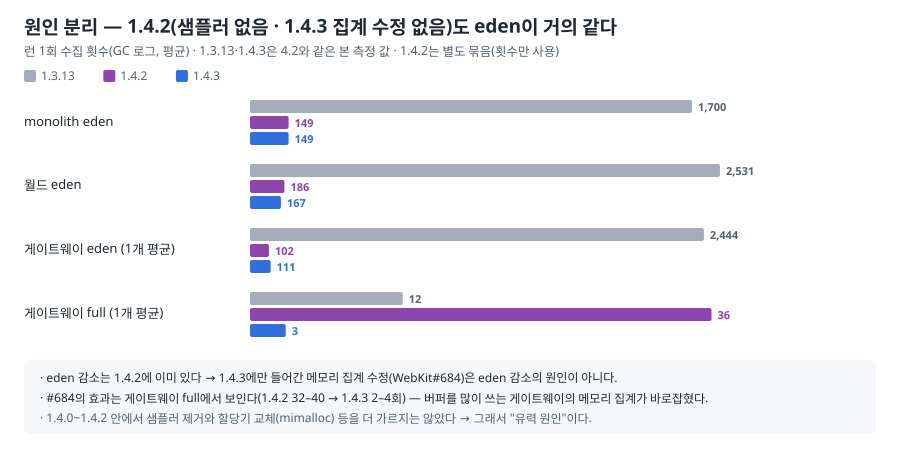

- 1.4.2(샘플러는 이미 없고, 1.4.3의 메모리 집계 수정은 아직 없음)도 eden이 1.4.3과 거의 같다. 그래서 eden 감소는 1.4.0~1.4.2의 변경에서 왔다.
- 1.4.3의 집계 수정은 다른 곳에서 보인다 — 버퍼를 많이 쓰는 게이트웨이의 full 수집이 1.4.2에서는 1.3.13(≈12회)보다 오히려 많은 ≈36회였는데,
  1.4.3에서 ≈3회로 줄었다.
- 1.4.0~1.4.2 안에서 샘플러 제거와 할당기 교체를 더 가르지는 않았다. 그래서 "유력 원인"이라고 쓴다.

## 5. 후속 측정 — 수용 인원·GC 페이서·60분 연속 운전

전환 당일에는 같은 PC의 다른 작업으로 호스트가 바빠 미뤘던 세 가지를 다음 날(2026-10-14) 쟀다. 4장과 같이 **서버만** 바꾸고 봇(부하 생성기)은
1.3.13으로 고정했다. 측정 PC의 WSL은 띄운 직후 1분 넘게 다른 프로그램(설치기·초기화 스크립트)이 CPU를 써서, 그것이 가라앉은 뒤 시작했다.

### 5.1 수용 인원 — 게이트웨이 2개는 +20~32%, monolith는 사실상 그대로

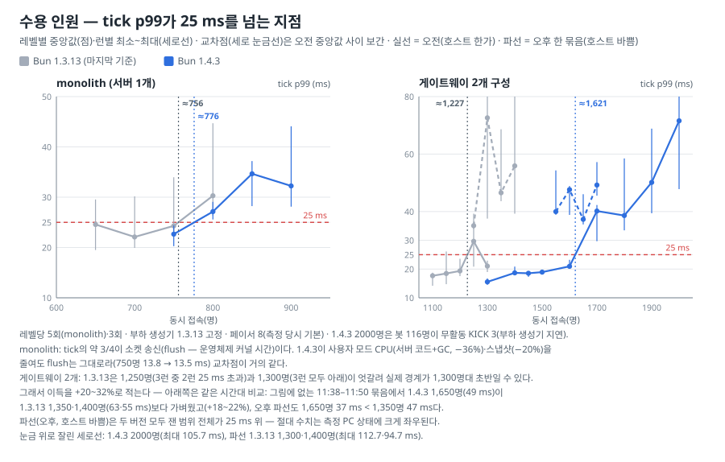

"몇 명까지 받나"는 동시 접속을 늘려 가며 tick p99가 25 ms를 넘는 지점(교차점)으로 쟀다. 1.3.13과 1.4.3을 번갈아, 인원 단계마다 monolith는 5회·
게이트웨이 2개는 3회 돌리고, 단계별 중앙값이 처음 25 ms를 넘는 두 단계 사이를 직선으로 이었다(보간 — 지난 수용 인원 측정과 같은 방법).
교차점은 호스트가 한가했던 오전 묶음으로 계산했다. 페이서는 측정 당시 기본 8이었다(새 기본 끔으로는 다시 재지 않았다 — 5.2에서 끔이 나쁘지
않았다).

| 구성 | 1.3.13 | 1.4.3 | 변화 |
|---|---|---|---|
| 게이트웨이 2개 | ≈1,227명 | ≈1,621명 | **+20~32%** |
| monolith | ≈756명 | ≈776명 | +3% — 런 사이 흔들림 범위 안이라 사실상 그대로 |

- **monolith가 그대로인 이유**: monolith tick의 약 3/4은 플레이어마다 소켓에 데이터를 쓰는 일(flush — 운영체제 커널이 쓰는 시간)이다. 1.4.3은
  사용자 모드 CPU(서버 코드 + GC·JIT 보조 스레드 — eden이 1/10로 줄었다, 4.2)를 750명에서 −36%, 스냅샷 계산을 −20% 줄였지만 flush는 13.8 →
  13.5 ms로 그대로다. 같은 인원의 p99는 7~10% 낮아졌지만(가장 나쁜 런은 800명에서 44.7 → 29.1 ms) 나머지 1/4만 줄어서, 25 ms를 넘는 인원
  (교차점)은 20명쯤만 움직였다.
- **게이트웨이 구성이 늘어난 이유**: 소켓 송신을 게이트웨이가 맡으니 월드 tick은 대부분 스냅샷 계산이고, 1.4.3이 그 시간을 줄인 만큼(1,300명
  tick 평균 15.0 → 11.6 ms) 더 받는다.
- **이득을 범위로 적은 이유**: 1.3.13은 1,250명에서 3런 중 2런이 25 ms를 넘었지만 바로 위 1,300명은 3런 모두 아래(19.0–22.9 ms)라, 위 방법
  (처음 25 ms를 넘는 두 단계 사이 보간)대로면 ≈1,227명이지만 실제 경계는 1,300명대 초반일 수 있다(오전 묶음에는 그 위 자료가 없다). 1.4.3의
  1,700명 점도 부하 생성기가 밀리기 시작한 런이 섞여 있어, 그 런을 빼면 ≈1,646명이다. 그래서 위쪽(+32%)은 위 방법으로 계산한 교차점의 비, 아래쪽
  (≈+20%)은 같은 시간대에 번갈아 잰 비교로 잡았다 — 11:38–11:50 묶음에서 1.4.3 1,650명(p99 49 ms)이 1.3.13 1,350명(63 ms)·1,400명(55 ms)보다
  가벼웠다(1,650 ÷ 1,400 = 1.18, 1,650 ÷ 1,350 = 1.22). 이 묶음은 오전보다 호스트가 무거워 교차점 같은 절대값에는 쓰지 않지만, 두 버전을 번갈아
  돌려 호스트 상태가 양쪽에 같이 걸리므로 비교에는 쓴다.
- **절대 수치는 측정 PC 상태에 크게 좌우된다**: 오후(14:03–14:27)에 호스트가 바쁠 때 같은 구간을 한 묶음으로 다시 재니, 두 버전 모두 잰
  범위 전체가 25 ms를 넘었다(1.3.13 1,250명 p99 35 ms, 1.4.3 1,550–1,700명 37–49 ms — 그림의 점선). 그래도 같은 묶음 안에서 1.4.3 1,650명(37 ms)이
  1.3.13 1,350명(47 ms)보다, 1.4.3 1,700명(49 ms)이 1.3.13 1,400명(56 ms)보다 가벼워 차이의 방향은 오전과 같다. 위 교차점은 이 PC가 한가할 때의 값이다.
- 처음 기록에서는 "두 버전 모두 50명 사이에서 p99가 급변한다 — 측정 PC 전체 포화"로 해석했지만, 급변 위쪽 점이 모두 호스트가 더 무거운
  시간대에 잰 것이어서(검증에서 지적) 그 해석은 버렸다. 교차점을 넘으면 p99가 빠르게 오르는 것(1.4.3 1,600명 21 ms → 1,700명 30–42 ms)까지만
  사실로 남긴다.
- 지난 수용 인원 측정(이진 전환 전 코드·1.3.13)은 monolith ≈678명 / 게이트웨이 2개 ≈1,159명이었다. 이번 1.3.13 수치가 더 큰 데는 그사이 코드
  변경(GC 페이서·이진 전환)과 측정 도구 수정, 측정한 날의 차이가 섞여 있어 나누지 않았다.

### 5.2 GC 페이서 — 1.4.3에서는 끈다

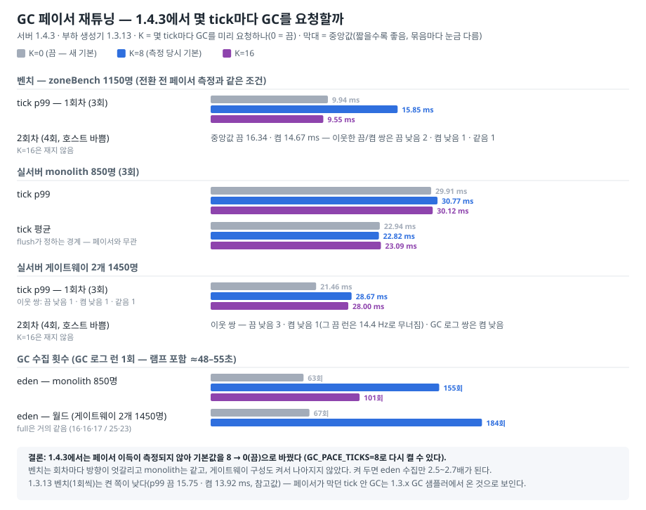

GC 페이서는 tick 사이 쉬는 시간에 GC를 미리 요청해서 GC가 tick 도중에 시작되지 않게 하는 장치다. 1.3.13 시절 tick p99 꼬리를 줄이려고 넣었고
기본은 8 tick마다였다. 1.4.3에서 끔(0)·8·16을 번갈아 쟀다.

- 벤치는 회차 중앙값이 엇갈리고(1회차 끔 9.94 < 켬 15.85, 2회차 끔 16.34 > 켬 14.67 ms), 바로 이웃해 돈 끔/켬 쌍은 두 회차 합쳐 끔 낮음 4·
  켬 낮음 2·같음 1이다. monolith는 셋이 같다. 게이트웨이 구성도 켜서 나아지지 않았다(이웃 쌍 끔 낮음 4·켬 낮음 3·같음 1 — 2회차 끝 GC 로그 런 쌍
  포함).
- 켜 두면 짧은 청소(eden)만 2.5~2.7배로 늘고(monolith 63 → 155회, 월드 67 → 184회/런) 전체 청소(full)는 그대로다. CPU나 tick이 더 든 것은
  측정되지 않았다 — 켤 이유도, 꼭 끌 이유도 약해서 단순한 쪽을 골랐다.
- K=16은 벤치 1회차에서 셋 중 가장 짧았지만 실서버에서는 끔보다 낫지 않아 고르지 않았다.
- 1.3.13에서는 이번에도 페이서를 켠 쪽이 낮았다(벤치 1회씩: p99 끔 15.75 · 켬 13.92 ms — 참고값). 페이서가 막던 "tick 안 GC"는 1.3.x의 GC
  샘플러(2장)가 만든 것으로 보이고(유력 원인), 1.4.3에서는 샘플러와 함께 보이지 않는다.
- **결정: 기본값을 8 → 0(끔)으로 바꿨다.** 1.3.x 계열 런타임으로 돌리거나 tick 안 GC 꼬리가 다시 보이면 `GC_PACE_TICKS=8`로 켠다.
- 같은 PC의 다른 작업으로 호스트가 시간대에 따라(간헐적으로) 바빴다(같은 설정 tick 평균이 수용 인원 단계 12.8–13.8 → 1회차 14.6–18.0 → 2회차
  21.6–29.0 ms, 2회차 끝 GC 로그 런은 다시 16.1 ms).
  그래서 실서버는 절대값보다 바로 이웃해 돈 끔/켬 쌍끼리 비교했다. 그림의 2회차는 막대 대신 쌍 비교 결과만 적었다.

### 5.3 60분 연속 운전 — 쌓이는 것이 없다

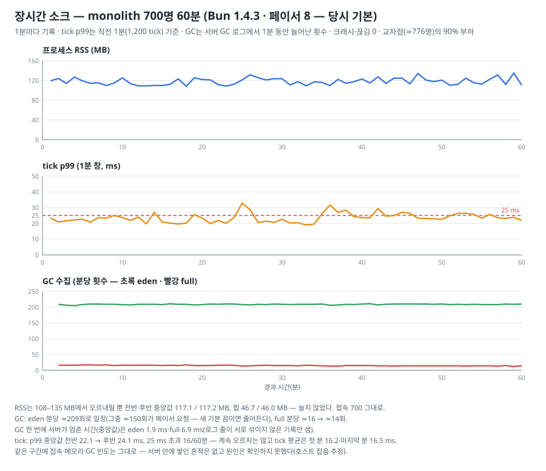

monolith 700명(1.4.3 교차점의 약 90%)을 60분 돌리며 1분마다 메모리·tick·GC를 기록했다. 페이서는 켠 상태(당시 기본 8)였고, 새 기본(끔)으로는
아직 다시 돌리지 않았다.

- 크래시·끊김·kick 0. 60분 동안 tick 72,000개(= 60분 × 20 Hz)를 빠짐없이 돌렸다(50 ms를 넘긴 tick 15개, 100 ms를 넘긴 tick 0, 36분 무렵 tick이
  밀린 적 1번 — 78.7 ms).
- 메모리(RSS)는 108–135 MB에서 오르내릴 뿐 전반·후반 중앙값이 117.1 / 117.2 MB, 힙도 46.7 / 46.0 MB로 늘지 않았다.
- GC는 eden이 분당 ≈209회로 60분 내내 일정했고(그중 분당 ≈150회가 페이서 요청이라 새 기본 끔이면 줄어든다), full은 분당 ≈16 → ≈14회로 늘지
  않았다.
- tick은 후반이 조금 높았다 — 1분 창 p99 중앙값 전반 22.1 → 후반 24.1 ms, 25 ms를 넘은 분이 60분 중 16분(전반 5분 — 9·14·19·
  25–26분, 후반 11분 — 35–38·42·45–46·52–54·56분). 700명은 교차점의 90%라 1분 창 p99가 25 ms 근처를 오르내린다. 계속 오르는 모양은 아니고 마지막 분 tick 평균(16.5 ms)도 첫 분
  (16.2 ms)과 비슷하다. 같은 구간에 접속·메모리·GC 빈도는 그대로라 서버 안에 무엇이 쌓인 흔적은 없다 — 호스트 잡음으로 추정하지만 확인하지는
  못했다.

## 6. 측정하며 배운 것

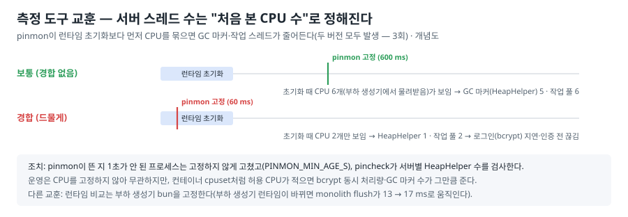

- **서버 스레드 수는 "처음 본 CPU 수"로 정해진다.** 측정 스크립트(pinmon)가 서버 런타임이 초기화되기 전에 CPU를 묶으면 GC 마커·작업 스레드가
  줄어든다. 지난 측정에서 3번 일어났다 — 1.4.3 월드 1회는 로그인(bcrypt)이 밀려 봇 55명이 인증 전에 끊겼고, 1.4.3 monolith 1회는 핸드셰이크가
  12초까지 늘었고, 1.3.13 게이트웨이 1회는 접속 문제 없이 GC 마커만 줄었다. 두 버전 모두에서 일어났으니 런타임 문제가 아니라 측정 도구 문제다.
  뜬 지 1초가 안 된 프로세스는 고정하지 않게 고쳤고, 런마다 서버 스레드 수를 검사한다(5장 후속 측정부터 적용 — 그 런은 전부 스레드 수 정상). 이 보고서 결과 중에서는 1.3.13
  게이트웨이 2개·1,200명의 중앙값 런이 그 경합 런이다 — 그 런을 빼도 결론은 같다(4.1).
- **런타임 비교는 부하 생성기를 고정해야 한다.** 서버는 같은 1.4.3인데 봇(부하 생성기)까지 1.4.3으로 바꾸면 monolith의 소켓 쓰기(flush)가
  13 → 17 ms로 늘고, tick 평균이 ≈21 ms로 1.3.13 기준선(≈18.5 ms)보다도 길어 보인다. 같은 PC 안 통신이라 받는 쪽(봇) 동작이 보내는 쪽(서버)
  비용에 섞이기 때문이다. 어느 쪽이 실제 플레이어에 가까운지는 모른다. 그래서 monolith 이득(−10%)은 "봇 고정 조건의 값"으로만 읽고, 실제 클라·
  실제 네트워크에서 다시 잰다(8장).
- **측정 PC의 상태가 시간대마다 다르다.** WSL(Windows 안의 리눅스 — 측정 환경)은 명령이 끝나면 내려갔다가 다음 명령 때 다시 뜨는데, 그때
  설치기·초기화 스크립트가 1분 넘게 CPU를 쓴다. 그 사이 돌린 예비 측정 한 런(게이트웨이 구성 1,600명)은 p99가 29 ms(본 측정 21 ms)였지만 다른
  예비 측정은 높지 않아 원인을 단정하지 못했다 — 그래도 가라앉기를 기다린 뒤 시작한다. 같은 날 같은 설정(게이트웨이 2개 1,450명·K=8)의 tick
  평균이 시간대에 따라 12.8–13.8 → 21.6–29 ms로 무거워지기도 했다(같은 PC의 다른 작업 추정). 그래서 버전·설정 비교는 한 묶음 안에서 번갈아
  돌린다. 처음에는 오전 점과 더 바쁜 시간대 점을 이어 "50명 사이 급변"으로 읽었다가 버렸고(5.1), 그 구간을 한 묶음으로 다시 쟀을 때는 호스트가
  바빠 두 버전 모두 25 ms 위라 교차점을 얻지 못했다.

## 7. 호환성 — 바뀐 것이 없다

서버 송신·클러스터 코드가 기대는 Bun 소켓·타이머·프로세스 동작을 같은 확인 스크립트로 두 버전·두 OS에서 돌렸다 — 하나라도 달랐으면 코드를
고쳐야 했다.

| 확인 | 결과 |
|---|---|
| 전체 시험 (Windows) | 서버 단위 2,538 · 회귀 12 · 통합 103 · 클러스터 14 — 실패 0 (Windows는 OS 전용 시험 일부를 건너뛰어 수가 적다) |
| 전체 시험 (Linux) | 서버 단위 2,543 · 회귀 12 · 통합 103 · 클러스터 15 — 실패 0 |
| 와이어 골든(바이트 단위) | 변화 없음 |
| 연결을 끊을 때(`end()`) 정리 코드가 즉시 실행 | 두 버전 같음 |
| 소켓이 일부만 써도 내부에 쌓아 두지 않음, 다시 쓸 수 있을 때 알림 | 두 버전 같음 |
| 여러 소켓에서 동시에 온 데이터를 다 처리한 뒤 예약 작업 1회 | 두 버전 같음 |
| 유휴 연결 타임아웃 1초 설정이 실제로 끊기는 시각 | 두 버전 같음 (Linux 4.0 s · Windows ≈3.3 s) |
| unix 소켓 파일 정리 | 두 버전 같음 |
| 슈퍼바이저 IPC(종료 메시지·부모가 죽을 때 자식) | 두 버전 같음 |
| 로그인 비밀번호 계산(bcrypt) 처리량 | 두 버전 같음 |

- 위 확인 스크립트는 `tools/perf/runtime/`에 있다 — 다음 Bun 업그레이드 때 그대로 다시 돌린다.
- CI의 bun 버전과 `@types/bun`을 1.4.3으로 고정했다(종전 `latest`).

## 8. 남은 과제

| 분류 | 과제 |
|---|---|
| 측정 (다음) | 실제 클라(Unity)·실제 네트워크·다른 PC에서 수용 인원과 monolith 이득(봇 고정 조건 −10%) 확인 — 이번 수치는 측정 PC 상태에 묶여 있을 수 있다(5.1). 새 기본(페이서 끔)으로 60분 운전 재확인(5.3) |
| 측정 기준 | 부하 생성기 런타임을 언제 1.4.3으로 옮길지 결정(옮기면 기준선을 다시 잰다), 측정 서버를 처음부터 CPU에 고정해 스레드 수 경합을 원천 차단(6장) |
| 운영 | 더 많은 인원이 필요하면 monolith 대신 게이트웨이 구성을 쓴다 — monolith의 한계는 소켓 송신이라 런타임을 올려도 늘지 않았다(5.1) · GC 페이서는 기본 끔 — 1.3.x 런타임으로 되돌리면 `GC_PACE_TICKS=8`(5.2) · 컨테이너처럼 허용 CPU가 적은 환경에서는 bcrypt 동시 처리량을 점검한다(서버 스레드 수가 허용 CPU 수를 따른다) |
| 분석 (필요하면) | 1.4.0~1.4.2 안에서 GC 감소 원인 세분(샘플러 제거 대 할당기 교체), 1.3.13에서 보인 "월드 할당 증가"의 원인(1.4.3에서는 재현 안 됨) |
| 개발 환경 | 개발 PC도 1.4.3으로 올렸다. 측정 PC(WSL)의 기본 bun은 비교용으로 1.3.13을 유지(1.4.2·1.4.3은 별도 경로) |

## 9. 용어 풀이

| 용어 | 뜻 |
|---|---|
| Bun | 이 서버가 도는 자바스크립트/타입스크립트 런타임(엔진 + 표준 라이브러리) |
| tick | 서버가 게임 상태를 한 번 갱신하는 단위. 20 Hz라 50 ms마다 1번 |
| p99 | 가장 느린 1%의 경계값. 이 프로젝트는 tick p99 25 ms를 수용 인원 한계로 본다 |
| 수용 인원(교차점) | 동시 접속을 늘려 가며 tick p99가 25 ms를 넘는 지점 |
| monolith / 게이트웨이 2개 구성 | 서버 프로세스 1개 / 월드 1 + 게이트웨이 2(게이트웨이가 클라 소켓, 월드가 게임 로직) |
| IPC | 월드와 게이트웨이 사이 통신 |
| 런 · A · B | 부하 시험 1회 실행 / 이 보고서에서 A = 서버 Bun 1.3.13, B = 서버 Bun 1.4.3(앞 보고서의 A·B와 뜻이 다르다) |
| 이벤트 루프 | 런타임이 소켓·타이머 일을 하나씩 꺼내 처리하는 반복 |
| 힙 · 할당 · 할당기 | 자바스크립트 객체가 사는 메모리 / 새 메모리를 만드는 것 / 그 일을 맡는 부품(1.4에서 mimalloc으로 교체) |
| GC · eden · full | 안 쓰는 메모리 청소. eden = 새로 만든 것만 보는 짧은 청소, full = 전체 청소 |
| GC 샘플러 | 1.3.x에서 이벤트 루프마다 힙을 재서 16 ms 뒤 GC를 다시 걸던 장치(1.4.0에서 제거) |
| GC 페이서 | 이 서버가 tick 사이 쉬는 시간에 GC를 미리 요청하는 장치(`GC_PACE_TICKS` — 몇 tick마다 요청할지) |
| GC 마커(HeapHelper) | GC를 돕는 런타임 내부 스레드 |
| 메모리 집계 수정(WebKit#684) | GC가 "얼마나 썼나"를 셀 때 바이너리 버퍼(typed array)를 잘못 세던 것을 고친 1.4.3 변경 |
| 코어 | CPU 사용량 단위. 0.47 코어 = 코어 1개의 47% |
| flush | 모아 둔 송신 데이터를 소켓에 실제로 쓰는 단계 |
| 스냅샷 | 매 tick 주변 엔티티의 변화를 모아 클라에 보내는 단계 |
| RSS | 프로세스가 실제로 차지한 물리 메모리 |
| rtt99 · lag99 | 봇이 잰 PING 왕복 지연의 99번째 백분위 / 스냅샷 도착 지연이 측정 창 동안 (봇별 최소 대비) 늘어난 정도의 99번째 백분위 |
| 루프백 | 같은 PC 안에서 주고받는 통신(봇과 서버) |
| bcrypt | 로그인 비밀번호 확인 계산. 일부러 느리게 만들어 작업 스레드 수에 민감하다 |
| 램프 | 봇이 접속해 들어오는 시작 구간(초당 100명) |
| 부하 생성기 · 측정 도구(하네스) | 봇 수백~수천 명을 흉내 내는 도구(`tools/loadgen`) / 측정을 돌리는 스크립트 묶음 |
| pinmon | 측정 중 프로세스를 정해진 CPU에 고정하는 측정 PC 스크립트 |
| 프로브 | 런타임의 특정 동작만 확인하는 작은 스크립트(`tools/perf/runtime/`) |
| 소크(soak) | 오래 돌려 메모리 증가·크래시·성능 저하가 없는지 보는 시험 |
| 벤치(zoneBench) | 네트워크 없이 서버 한 프로세스 안에서 tick만 돌려 재는 도구(`tools/perf/zoneBench.ts`) |
| WSL | Windows 안에서 리눅스를 돌리는 기능 — 측정 PC의 리눅스 환경 |
| 커널(sys 시간) | 운영체제 핵심부. 소켓 쓰기처럼 커널이 대신 하는 일에 든 CPU 시간은 런타임을 바꿔도 거의 줄지 않는다 |
| 보간 | 잰 두 점 사이를 직선으로 이어 그 사이 값을 어림하는 것 |
| 포화 | CPU 여유가 없어 부하가 조금만 늘어도 지연이 크게 뛰는 상태 |
| 엔티티 | 게임 안의 플레이어·몬스터·떨어진 아이템 같은 개체 |
| 예비 측정(사전 스캔) | 본 측정 전에 범위를 대강 훑어보는 측정 |
| 호스트 | 측정 PC 자체(WSL을 돌리는 Windows 본체) — 다른 작업이 돌면 측정과 같은 물리 코어를 나눠 쓴다 |
| 묶음 | 같은 시간대에 A·B(또는 설정)를 번갈아 돌린 런 모음 — 묶음 안에서는 호스트 상태가 양쪽에 같이 걸린다 |
| kick · KICK 3 | 서버가 연결을 끊는 것 / 그중 일정 시간 아무것도 보내지 않아 끊는 경우(무활동) |

## 부록. 원자료와 그림

- 측정 원자료: 측정 PC WSL `~/perf-bun14`(A/B)·`~/perf-bun14b`(분해·B6 재측정)·`~/perf-bun142`(원인 분리), 후속 측정 `~/perf-cap14`(수용 인원)·`~/perf-cap14c`(수용 인원 오후 한 묶음)·
  `~/perf-pace14`·`~/perf-pace14b`(GC 페이서)·`~/perf-soak14`(60분 운전)·`~/perf-chain14`(실행 스크립트), 분석 스크립트 `~/an/`.
- 수치의 정본은 [perf-baseline.md](../perf-baseline.md)의 해당 절이다.
- 그림은 같은 폴더 생성기로 다시 만든다: `bun run docs/reports/img/bun-1.4.3/gen.ts docs/reports/img/bun-1.4.3` (데이터는 `gen.ts`·`data.ts`).
